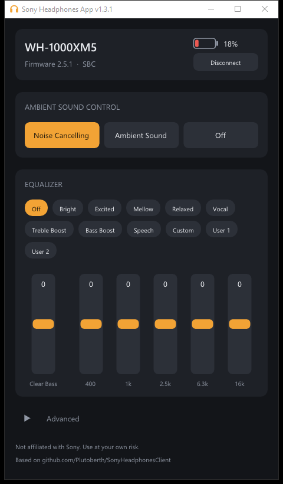

<h1 align="center">Sony Headphones Client — XM5 edition</h1>

<p align="center">
  A desktop app for controlling Sony headphones from your PC, with support for the <b>WH-1000XM5</b>.<br/>
  No phone needed: noise cancelling, ambient sound, equalizer and battery, right from Windows.
</p>

<p align="center">
  
</p>

> [!WARNING]
> **This program is not affiliated with Sony.** It talks to your headphones using a reverse-engineered protocol. You are responsible for any damage that may occur while using it.

## Features

Tested on a **WH-1000XM5** (firmware 2.5.1) on Windows:

- **Noise Cancelling / Ambient Sound / Off**, with the ambient level (1–20) and Focus on Voice
- **Equalizer**: all presets (Bright, Excited, Mellow, Relaxed, Vocal, Treble Boost, Bass Boost, Speech…) plus custom Clear Bass and 5-band settings
- **Battery level**, refreshed every minute, and whether it's charging
- **Device info**: model, firmware version and the Bluetooth codec in use (SBC / AAC / LDAC)
- **Stays in sync**: shows your headphones' real settings when it connects, and follows changes you make with the button on the earcup
- **Tray icon** (Windows): hover for battery and mode, right-click to switch Noise Cancelling / Ambient / Off. Closing the window keeps the app running in the tray
- **Auto-connect** when you have one pair of Sony headphones paired

Not supported yet: Speak-to-Chat, wind noise reduction, and other XM5-only settings.

## Supported headphones

| Headphones | Status |
|---|---|
| WH-1000XM5 | ✅ Tested: everything listed above |
| WH-1000XM4 | Probably works (it's reported to use the same newer protocol), but untested |
| WH-1000XM3 and older | Use **Advanced → untick "XM4/XM5 command format"** for the original controls, including Virtual Sound |

If you try it on other Sony headphones, please open an issue and say what works.

## Using it

1. Pair your headphones with Windows and make sure they're connected.
2. Start `SonyHeadphonesClient.exe`. If you have one pair of Sony headphones, it connects by itself; otherwise pick them from the list.
3. Close the window to send it to the tray. Use **Exit** in the tray menu to quit.

Every message to and from the headphones is written to `SonyHeadphonesClient.log` next to the app, which is useful for reporting problems or working out new features.

## Building

Clone with the [Dear ImGui](https://github.com/ocornut/imgui) submodule:

```sh
git clone --recurse-submodules https://github.com/android205/SonyHeadphonesClientXM5.git
```

If you already cloned without it: `git submodule update --init`.

### Windows

Needs Visual Studio 2022 with the **Desktop development with C++** workload (it includes CMake). From a *Developer Command Prompt*:

```sh
cd Client
cmake -S . -B build -G "Visual Studio 17 2022" -A x64
cmake --build build --config Release
```

The app ends up in `build\Release\SonyHeadphonesClient.exe`.

> If the build fails with `FileTracker` / `FTK1011` errors, your folder path is too long for MSBuild. Clone to a short path such as `C:\src`, or use `-G Ninja` with the build folder somewhere short.

### Linux

Debian / Ubuntu:

```sh
sudo apt install libbluetooth-dev libglew-dev libglfw3-dev libdbus-1-dev
```

Fedora:

```sh
sudo dnf install bluez-libs-devel glew-devel glfw-devel dbus-devel
```

Then build with CMake as above (without the `-G`/`-A` options). The Linux build hasn't been tested with the XM5 changes.

### macOS

The Xcode project in `Client/macos` hasn't been updated for this fork yet (it's missing the new `Log.cpp`), so it won't build as-is.

## Protocol notes (XM4/XM5)

For anyone extending this. Payloads are sent as `DATA_MDR` (`0x0C`) messages. Replies use the query byte + 1, and unprompted notifications use + 3.

| Feature | Query | Reply / notify | Set |
|---|---|---|---|
| Protocol info | `00 00` | `01 00 …` | — |
| Model / firmware | `04 01` / `04 02` | `05 01 <len> <text>` | — |
| Supported functions | `06 00` | `07 00 <count> <id, value>…` | — |
| Battery | `22 00` | `23 00 <percent> <charging>` / `25 00 …` | — |
| Codec | `12 02` | `13 02 <codec>` (01 SBC, 02 AAC, 10 LDAC) | — |
| NC / ambient | `66 17` | `67 17 …` / `69 17 01 <on> <ambient> <voice> <level>` | `68 17 01 <on> <ambient> <voice> <level>` |
| Equalizer | `56 00` | `57 00 <preset> 06 <6 bands, 0–20>` / `59 00 …` | `58 00 <preset> 00`, or `58 00 A0 06 <bands>` for custom |
| Unknown on/off setting | `F6 0C` | `F7 0C 01 <00 on / 01 off>` / `F9 0C …` | `F8 0C 01 <state>` (accepted, but not Speak-to-Chat) |

The headphones expect every message they send to be ACKed promptly, or they keep resending it. The client runs a background reader thread for this.

## Credits

This is a fork of [Plutoberth/SonyHeadphonesClient](https://github.com/Plutoberth/SonyHeadphonesClient), by way of [Alpakash/SonyHeadphonesClientXM5](https://github.com/Alpakash/SonyHeadphonesClientXM5) (which found the XM5's Bluetooth service ID).

Original contributors:

* [Plutoberth](https://github.com/Plutoberth): initial work and Windows version
* [Mr-M33533K5](https://github.com/Mr-M33533K5): Bluetooth interface and other help
* [semvis123](https://github.com/semvis123): macOS version
* [jimzrt](https://github.com/jimzrt): Linux version
* [guilhermealbm](https://github.com/guilhermealbm): noise cancelling switch

## License

MIT. See [LICENSE](LICENSE).
